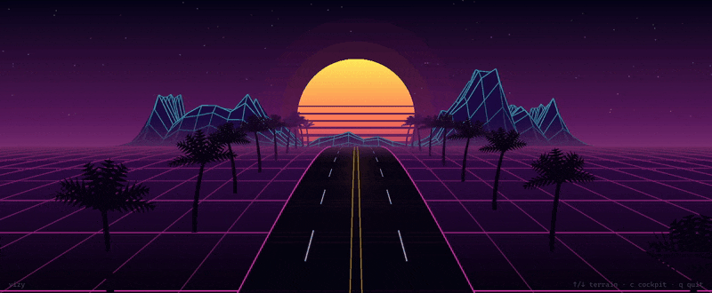
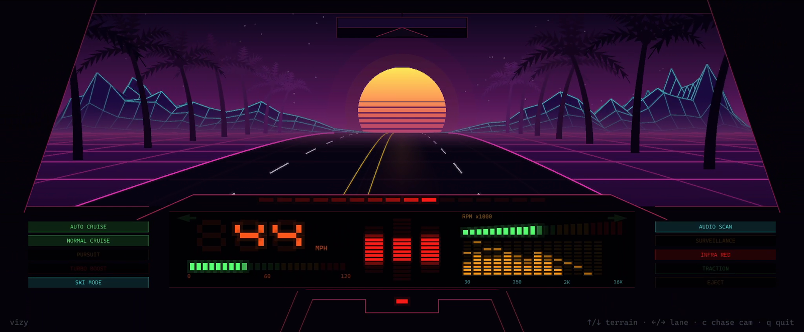

# vizy

An 80s synthwave drive that dances to whatever your PC is playing.



Play music, a video, a game, anything. vizy listens to your speakers
directly (no virtual audio cables or extra apps) and turns the sound into a
night drive:

- **The mountains are the spectrum.** Left channel on the left, right on the
  right, bass at the outer edges. The range ripples back through time.
- **The palms grow from the music.** Each one is shaped by the moment it
  appears: heavy bass droops the fronds, busy treble makes them fuller.
- **The car drives to the beat.** Speed follows loudness and surges on kicks;
  the sun pulses with the bass.
- **Hop into the cockpit** of an 80s supercar where every display (scanner,
  voice box, speedo, tach, spectrum analyzer, even the buttons) is part of
  the visualizer.
- **Play along.** Tap the arrow keys on the beat to surge the mountains and
  send waves rolling down the road. Signal a lane change and the car swerves
  on the next bass hit.



## Download

1. Grab `vizy-0.1.0-windows-x64.zip` from the
   [Releases page](https://github.com/D33pfield/vizy/releases).
2. Unzip it anywhere and run `vizy.exe`.
3. Play some music.

Windows 10 or 11, 64-bit. Nothing to install.

> **"Windows protected your PC"?** vizy isn't code-signed (that costs
> money and this is free software), so SmartScreen warns on first run. Click
> **More info → Run anyway**. You can always build it yourself instead (see
> below).

## Controls

| Key | Does |
|---|---|
| `c` | Swoop between the chase view and the cockpit |
| `↑` | Surge: the mountains leap up (tap on the beat) |
| `↓` | Ground wave: a swell rolls down the road toward you (taps stack) |
| `←` `→` | Cockpit only: signal a lane change; it happens on the next deep bass hit |
| `Alt+Enter` / `F11` | Toggle fullscreen (`Esc` also leaves it) |
| `q` / `Esc` | Quit |

## Known limitations

- Windows only (it uses WASAPI loopback capture).
- Listens to the **default output device** at startup. If you switch
  outputs while it runs (speakers → headphones), restart vizy.
- Apps using exclusive-mode audio can't be captured (rare).

## Building from source

You need [Rust](https://rustup.rs).

**On Windows:**

```powershell
cargo build --release --target x86_64-pc-windows-msvc
```

**From WSL or Linux** (cross-compiling, how vizy is developed):

```bash
# Arch; other distros have a mingw-w64 package too
sudo pacman -S mingw-w64-gcc
rustup target add x86_64-pc-windows-gnu
cargo build --release   # .cargo/config.toml targets Windows by default
```

The `.exe` lands in `target/<target>/release/vizy.exe`. From WSL,
`./run.sh release` builds, copies it to your Windows `bin` folder and
launches it.

How it works under the hood: [docs/DESIGN.md](docs/DESIGN.md).

## Feedback

This is v0.1.0 and ideas are very welcome. Open an
[issue](https://github.com/D33pfield/vizy/issues) with what you'd like to
see, or what broke.

## License

Public domain, via the [Unlicense](UNLICENSE). Do whatever you like with it.

## Credits

Made by [D33pfield](https://github.com/D33pfield), built together with
Claude (Anthropic).
